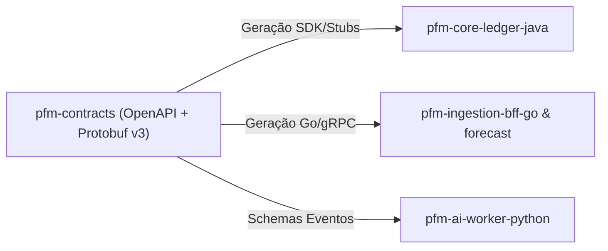

# PFM Contracts — Fonte Única da Verdade (OpenAPI 3.1 & Protobuf v3)

[](CONTRIBUTING.md)
[](CHANGELOG.md)
[](https://sorobanerp.github.io/pfm-docs/)

---

## 1. Visão Geral & Papel na Arquitetura

Single Source of Truth para contratos **REST (OpenAPI 3.1)**, **gRPC (Protobuf v3)** (`LedgerService`, `TenantAdminService`, `UserProfileService`, `ForecastService`) e esquemas de eventos **Apache Kafka**.

- **Repositório:** `Sorobanerp/pfm-contracts`
- **Vínculo com `pfm-docs`:** `ADR-002, ADR-003, ADR-005 | US-01 a US-13`



---

## 2. Pré-requisitos & Variáveis de Ambiente

### Pré-requisitos
- `buf` CLI (v1.x+)
- `make`, `protoc` (quando aplicável)

### Variáveis de Ambiente (Sem Segredos Hardcoded)
| Variável | Padrão Local | Descrição |
| :--- | :---: | :--- |
| `BUF_CONFIG` | `buf.yaml` | Arquivo de configuração de lint e breaking-change detection |

> **Segurança (Zero-Trust):** Nunca commite tokens, senhas, chaves AWS ou strings de conexão com credenciais reais. Utilize `.env` local (ignorado no `.gitignore`) ou AWS Secrets Manager / GitHub OIDC.

---

## 3. Como Executar Localmente

```bash
make help
# Gerar stubs e validar contratos localmente
make generate || buf generate
```

---

## 4. Como Testar e Validar

```bash
# Validar lint e retrocompatibilidade dos contratos Protobuf/OpenAPI
buf lint
# Verificar breaking changes contra develop
buf breaking --against '.git#branch=develop'
```

---

## 5. Como Provisionar / Validar na Nuvem

1. Fluxo Gitflow: `feat/*` $\rightarrow$ `develop` $\rightarrow$ `release/vX.Y.Z` $\rightarrow$ `main`.
2. Pós-deploy: serviços consumidores (`pfm-core-ledger-java`, `pfm-ingestion-bff-go`, `pfm-forecast-engine-go`) consomem a tag SemVer publicada.

Consulte [CONTRIBUTING.md](CONTRIBUTING.md) para regras de Conventional Commits e [CHANGELOG.md](CHANGELOG.md) para histórico de versões.
